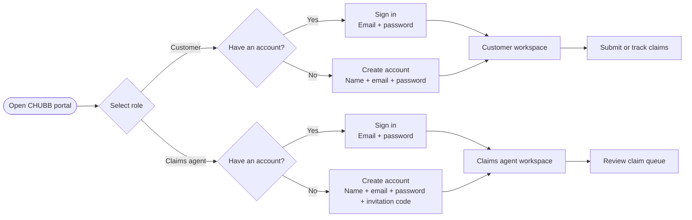
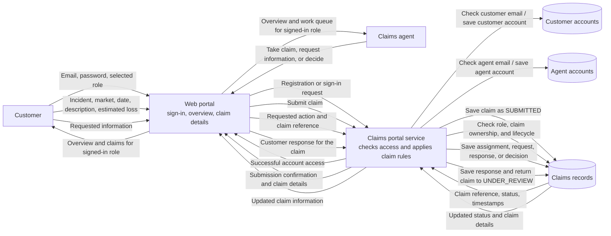
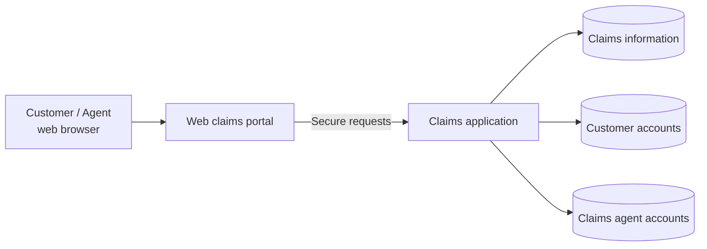

# Insurance Claims Management Portal

## Executive Summary

The Insurance Claims Management Portal is a digital claims experience for customers and claims agents. It brings claim submission, status tracking, information exchange, review, and decisioning into one secure and easy-to-use workspace.

The solution supports the complete claims lifecycle across six markets:

**Australia (AU) | Hong Kong (HK) | Indonesia (ID) | Malaysia (MY) | Singapore (SG) | Thailand (TH)**

Customers receive a clear place to submit and monitor claims. Claims agents receive a focused queue for assigned work and new submissions. Each action is recorded against the claim so the latest status remains clear to authorised users.

---

## Purpose

This portal is designed to:

- Make claim submission simple and consistent.
- Give customers visibility of claim progress.
- Help agents manage workloads and complete reviews efficiently.
- Reduce unnecessary back-and-forth by capturing information requests and responses against the claim.
- Maintain clear, controlled outcomes of **settled** or **rejected**.
- Separate customer and claims-agent access through role-based workspaces.

---

## Client Journey and Data Flow

The client experience has two clearly separated flows:

1. **Account access** - Existing users sign in; new users register.
2. **Claim journey** - A claim moves through visible statuses from submission to a final decision.

### 1. Account Access



A successful sign-in or registration creates a secure session and takes the user directly to the **Overview** page in the appropriate workspace. Signing out ends that session.

### 2. Claim Journey and Status Flow

```mermaid
flowchart LR
    Register([Customer<br/>sign in or register]) --> Submit[Customer submits claim]
    Submit --> Submitted[[1. SUBMITTED]]

    Submitted -->|Agent takes the claim| Review[[2. UNDER REVIEW]]
    Review -->|Agent needs more details| InfoRequired[[3. INFORMATION REQUIRED]]
    InfoRequired -->|Customer opens the claim| CustomerInfo[Customer provides additional information]
    CustomerInfo -->|Additional information received| ReviewAgain[[4. UNDER REVIEW]]

    ReviewAgain -->|Claim approved| Settled[[5A. SETTLED]]
    ReviewAgain -->|Claim declined| Rejected[[5B. REJECTED]]

    Settled --> CustomerStatus[Customer views final status]
    Rejected --> CustomerStatus
    Settled --> AgentStatus[Agent queue updated]
    Rejected --> AgentStatus
    Submitted -.-> AgentQueue[Agent sees new claim]
    AgentQueue -.-> Review
```



**Status definitions**

| Status | Trigger | Next available path |
|---|---|---|
| `SUBMITTED` | Customer submits the claim | Agent takes ownership and moves it to `UNDER_REVIEW` |
| `UNDER_REVIEW` | Agent starts review | Request information, settle, or reject |
| `INFORMATION_REQUIRED` | Agent requests additional details | Customer provides details and the claim returns to `UNDER_REVIEW` |
| `SETTLED` | Agent approves and records the settlement reason | Final status; no further review action |
| `REJECTED` | Agent declines and records the rejection reason | Final status; no further review action |

### 3. End-to-end information flow

The diagram below shows what information moves between each participant. It is intentionally written from a user and service perspective rather than as an implementation class diagram.



For account access, the service checks the selected email against both account stores before registration. Existing emails are rejected with a prompt to sign in. On sign-in, the selected role determines which account store is used to verify the password. Successful registration and sign-in establish a session; subsequent requests use that session and the role attached to it.

Claim changes are saved before the updated status is returned to the portal. Access checks limit customers to their own claims and agents to their assigned claims or unassigned submissions. A claim-reference lookup returns limited details and still requires an authorised signed-in user.

### How the flow works

1. **Choose a role** - The user opens the portal and selects **Customer** or **Claims Agent**.
2. **Sign in or register** - An existing user signs in with email and password. A new user selects **Create account**, enters the required details, and registers.
3. **Agent registration** - A new claims agent must also enter the configured organisation invitation code.
4. **Submit** - The customer submits a claim. It enters the lifecycle with the `SUBMITTED` status and appears in the agent queue.
5. **Start review** - The agent takes the claim. It changes to `UNDER_REVIEW`.
6. **Request additional information** - When needed, the agent sends a request. The status changes to `INFORMATION_REQUIRED`, and the customer sees the request in the claim details.
7. **Provide additional information** - The customer adds the requested information. The status returns to `UNDER_REVIEW` for continued review.
8. **Make a decision** - The agent records `SETTLED` or `REJECTED` with a reason. The selected status is the final claim outcome.
9. **View the outcome** - The customer and agent each see the latest status in their own workspace.

### Account and access flow

| Situation | Customer | Claims agent |
|---|---|---|
| Already registered | Select **Customer**, choose **Sign in**, then enter email and password | Select **Claims Agent**, choose **Sign in**, then enter email and password |
| New user | Choose **Create account**, enter full name, email, and password | Choose **Create account**, enter full name, email, password, and invitation code |
| After successful access | Opens the customer Overview page | Opens the claims-agent Overview page |
| Sign out | Ends the secure session and returns to sign-in | Ends the secure session and returns to sign-in |

### Related links

- [Customer and agent portal](http://localhost:5173/)
- [Landing page and sign-in](http://localhost:8080/)
- [Authentication API](#authentication-api)
- [Claims API reference](#api-reference)
- [Technical architecture](docs/ARCHITECTURE.md)

---

## Claim Statuses

| Status | Meaning | Available action |
|---|---|---|
| **Submitted** | The customer has submitted a complete claim. | An agent can take the claim and begin review. |
| **Under Review** | A claims agent is actively reviewing the claim. | Request information or record a decision. |
| **Information Required** | The agent has requested further details or evidence. | The customer provides additional information. |
| **Settled** | The claim has been approved and settled. | No further review action is required. |
| **Rejected** | The claim has been declined with a recorded reason. | No further review action is required. |

Typical journey:

```text
SUBMITTED
  -> UNDER_REVIEW
      -> INFORMATION_REQUIRED
          -> UNDER_REVIEW
              -> SETTLED
              -> REJECTED
```

---

## Customer Experience

Customers have a dedicated portal to:

- Create an account and sign in securely.
- Submit a new claim.
- View all of their claims.
- Track current status.
- Review an agent's information request.
- Provide requested additional information.
- View the assigned officer, submitted details, requested information, and decision reason.
- Look up limited claim status using a claim reference while signed in.

Customers can view only claims associated with their account. Reference-based lookup is also access-controlled and returns limited information without exposing claimant personal details.

---

## Claims Agent Experience

Claims agents have a role-specific workspace to:

- Create an account using an invitation code.
- Review unassigned submissions and assigned work.
- Take ownership of an unassigned claim.
- Request further information from the customer.
- Continue review after additional information is supplied.
- Record a settlement or rejection with a clear reason.
- Monitor claims by status.

Agent actions are controlled by the claim lifecycle. A claim cannot be settled or rejected before review, and invalid status transitions are not permitted.

---

## Information Captured

Each claim includes:

| Information | Description |
|---|---|
| Claim reference | Customer-facing reference in the format `CLM-` followed by a unique claim identifier |
| Claimant name and email | Customer and notification details |
| Market | Supported market: AU, HK, ID, MY, SG, or TH |
| Incident date | Date of the reported incident |
| Incident description | Summary of what occurred, up to 2,000 characters |
| Estimated loss | Claim amount, with a minimum value of 0.01 |
| Status | Current position in the claims lifecycle |
| Assigned officer | Agent responsible for the claim |
| Information request | Details requested from the customer |
| Additional information | Customer response to the request |
| Decision reason | Explanation associated with settlement or rejection |
| Submitted and updated timestamps | Record of claim creation and latest update |

---

## Security and Access

The portal applies role-based access and secure account practices:

- Separate customer and claims-agent sign-in roles.
- Passwords are stored as BCrypt hashes.
- Session-based authentication.
- Agent registration requires a private invitation code.
- Customers can access only claims registered to their account.
- Agents can access assigned claims and the unassigned submission queue.
- Signed-in reference lookup is limited to non-sensitive claim status information.
- Invalid transitions, missing claims, and invalid submissions return clear responses.

For production deployment, recommended controls include managed identity integration, multi-factor authentication, account lockout policies, session hardening, database migrations, audit history, and data retention policies.

---

## Solution Overview

The current release is a modular, maintainable application with a web portal and backend claims service.



The solution is synchronous and is intentionally designed as one deployable application for the current scope. This keeps claim updates, status changes, and user permissions consistent while remaining straightforward to operate.

---

## Running the Solution Locally

### Prerequisites

- Java 21
- Maven 3.9 or later
- Docker and Docker Compose
- Node.js and npm

### 1. Start the database

```powershell
docker compose up --build -d --wait
```

The local database setup provides separate stores for claims, customer accounts, and agent accounts.

### 2. Configure agent registration

Set a private, local-only invitation code:

```powershell
$env:AGENT_REGISTRATION_CODE = "replace-with-a-local-agent-invite"
```

The application has a local-development fallback code; set `AGENT_REGISTRATION_CODE` to a private value before using agent registration outside local development.

### 3. Start the application

```powershell
mvn spring-boot:run
```

The application is available at:

- **Landing page and sign-in:** http://localhost:8080/
- **Claims API:** http://localhost:8080/api/v1/

### 4. Start the web portal

```powershell
cd frontend
npm install
npm run dev
```

Open the React portal at **http://localhost:5173/**.

---

## API Reference

### Authentication API

Authentication endpoints are available under `/api/v1/auth`.

| Action | Method | Endpoint |
|---|---|---|
| Register a customer or claims agent | `POST` | `/api/v1/auth/register` |
| Sign in to the customer or agent workspace | `POST` | `/api/v1/auth/login` |
| Confirm the current signed-in session | `GET` | `/api/v1/auth/session` |
| Sign out | `POST` | `/api/v1/auth/logout` |

### Claims API

The claims service exposes versioned endpoints under `/api/v1/claims`.

| Action | Method | Endpoint |
|---|---|---|
| Submit a claim | `POST` | `/api/v1/claims/submit` |
| List claims for the signed-in role | `GET` | `/api/v1/claims/` |
| View claim details | `GET` | `/api/v1/claims/{claimId}` |
| View limited status by claim reference (signed-in users only) | `GET` | `/api/v1/claims/reference/{reference}` |
| Start review | `POST` | `/api/v1/claims/{claimId}/review` |
| Request additional information | `POST` | `/api/v1/claims/{claimId}/information-requests` |
| Provide additional information | `POST` | `/api/v1/claims/{claimId}/additional-information` |
| Settle a claim | `POST` | `/api/v1/claims/{claimId}/settlement` |
| Reject a claim | `POST` | `/api/v1/claims/{claimId}/rejection` |
| View the agent queue | `GET` | `/api/v1/claims/agent/queue` |

---

## Verification

The automated suite uses an isolated in-memory database and does not require Docker:

```powershell
mvn test
```

Coverage includes claim lifecycle rules, claim-service behaviour, authentication, REST workflows, validation, and persistence integration.

---

## Current Scope and Future Considerations

The current implementation provides a complete first-pass claims workflow. Future production readiness may include:

- Database migration management.
- Complete audit history and decision traceability.
- Paginated and filterable claims queues.
- Market-specific policy and document requirements.
- Document uploads and evidence management.
- Notifications for status and information changes.
- Multi-factor authentication and managed identity.
- Reporting and workload dashboards.
- Production database and session hardening.
- Integration with asynchronous services where a real business need is identified.

---

## Documentation

- [Architecture and Technical Workflows](docs/ARCHITECTURE.md)
