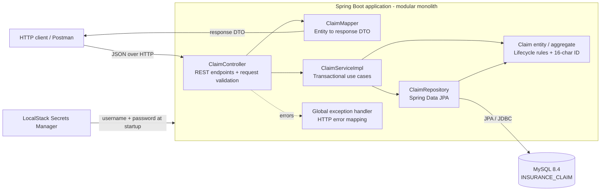
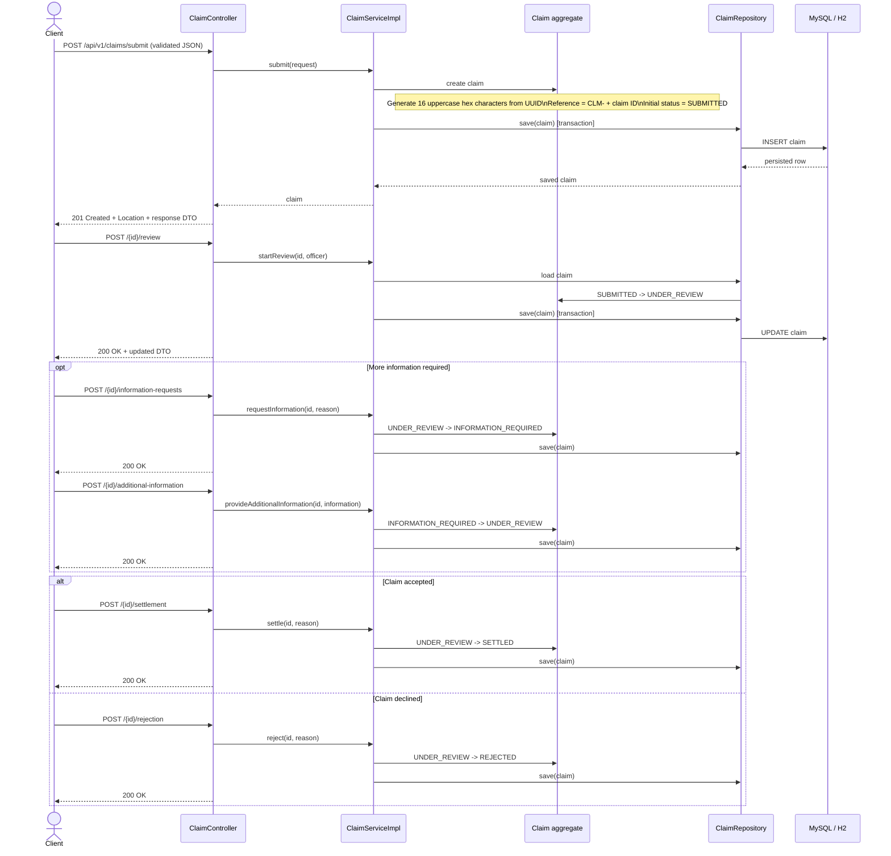
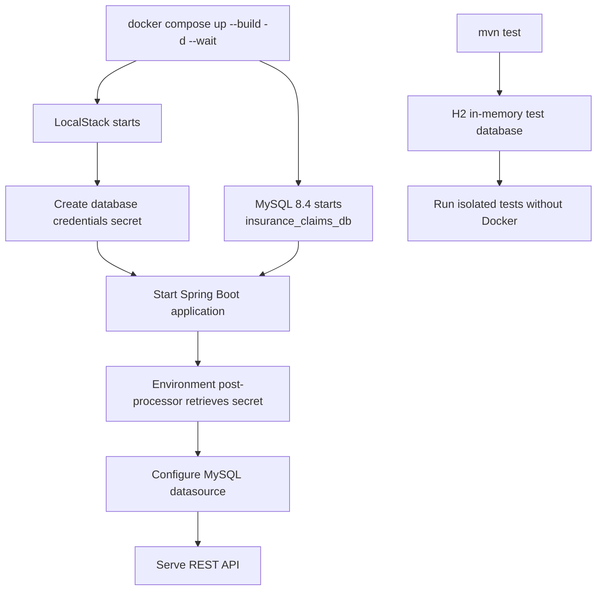

# Architecture and workflows

This document describes the application as currently implemented. It is a synchronous Spring Boot modular monolith; it does not currently use a message broker, separate microservices, or an external claims portal.

## Technology stack

| Area | Technology | Role |
|---|---|---|
| Language/runtime | Java 21 | Application and tests |
| Application framework | Spring Boot 3.4.5 | Application lifecycle and dependency injection |
| HTTP API | Spring MVC | Versioned REST endpoints under `/api/v1/claims` |
| Input validation | Jakarta Bean Validation | Validates request DTOs at the API boundary |
| Persistence | Spring Data JPA / Hibernate | Repository abstraction and ORM mapping |
| Runtime database | MySQL 8.4 | Local application persistence |
| Test database | H2 in-memory | Isolated integration-test persistence |
| Local secrets | LocalStack Secrets Manager | Supplies MySQL username/password during app startup |
| Build and tests | Maven, Spring Boot Test, JUnit 5, Mockito | Build, unit, mock, and integration tests |
| Local orchestration | Docker Compose | Starts MySQL and LocalStack |

## Architecture



The controller owns HTTP routing and request/response concerns. `ClaimServiceImpl` coordinates use cases and transaction boundaries. The `Claim` entity enforces lifecycle transitions. `ClaimRepository` is the persistence boundary, and `ClaimMapper` maps entities to API DTOs. The reference-tracking route returns a limited DTO that excludes claimant personal information.

## Claim submission and lifecycle workflow



Allowed transitions are `SUBMITTED -> UNDER_REVIEW -> INFORMATION_REQUIRED -> UNDER_REVIEW -> SETTLED` or `REJECTED`. Settlement and rejection require `UNDER_REVIEW`. Invalid transitions are reported as HTTP 409; a missing claim returns 404, and invalid request data returns 400.

## Startup and local environment workflow



The local credentials secret defaults to `insurance-claims/database` and contains non-blank `username` and `password` fields. Runtime overrides include `DB_USERNAME`, `DB_PASSWORD`, `DB_CREDENTIALS_SECRET_NAME`, `AWS_ENDPOINT_URL`, and `AWS_REGION`. The application fails startup if enabled secret retrieval or credential parsing fails; it does not silently substitute credentials. Tests disable secret retrieval and use an isolated H2 database.

## REST API

All paths are relative to `/api/v1/claims`.

| Method | Path | Purpose |
|---|---|---|
| `POST` | `/submit` | Submit a claim; returns 201 and a `Location` header |
| `GET` | `/` | List claims; optional `?status=UNDER_REVIEW` |
| `GET` | `/{claimId}` | Retrieve a claim by internal ID |
| `GET` | `/reference/{reference}` | Public claim tracking without claimant email |
| `POST` | `/{id}/review` | Assign an officer and start review |
| `POST` | `/{id}/information-requests` | Request additional information |
| `POST` | `/{id}/additional-information` | Submit requested information |
| `POST` | `/{id}/settlement` | Settle a reviewed claim |
| `POST` | `/{id}/rejection` | Reject a reviewed claim |

## Identifier and persistence notes

The internal `claimId` is the first 16 hexadecimal characters of a random UUID, stored uppercase, and mapped to `CLAIM_ID` with length 16. The public reference is `CLM-` followed by the internal ID. Truncating a UUID to 16 hexadecimal characters reduces collision resistance compared with storing the full UUID; the database uniqueness constraint is still enforced. Claims use optimistic locking via the `VERSION` field. Runtime schema configuration is `spring.jpa.hibernate.ddl-auto=update`; tests use `create-drop` against H2.

## Source layout

```text
src/main/java/com/chubb/claims/
  ClaimsApplication.java
  claim/
    controller/       # REST controller
    api/dto/          # Request and response DTOs
    api/mapper/       # Entity-to-DTO mapping
    domain/           # Status and market types
    entity/           # Claim persistence model and lifecycle behavior
    repository/       # Spring Data repository
    service/          # Use-case contract and implementation
  config/             # Secrets Manager startup integration
  exception/          # API exception handling
src/test/java/com/chubb/claims/
  claim/domain/       # Lifecycle and ID unit tests
  claim/service/      # Mocked service tests
  claim/api/          # REST and persistence integration tests
  config/             # Startup-configuration tests
```

## Build and verification

```shell
mvn test
```

Integration tests use H2 and MockMvc, so no Docker services are required for the test suite. For local runtime, start infrastructure and then the application:

```shell
docker compose up --build -d --wait
mvn spring-boot:run
```

## Current boundaries and follow-up architecture

This is one deployable application and one relational database. Authentication/authorization, database migrations, audit history, pagination, production secret management, and market-specific policy rules are not currently implemented. Kafka or other asynchronous messaging and separately deployed services are intentionally outside the current design; they can be introduced when a concrete integration or scaling requirement exists.
