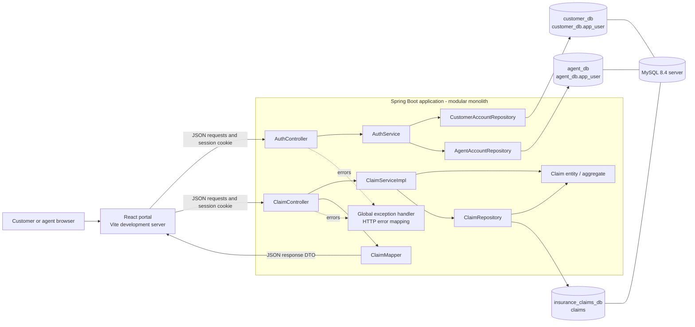
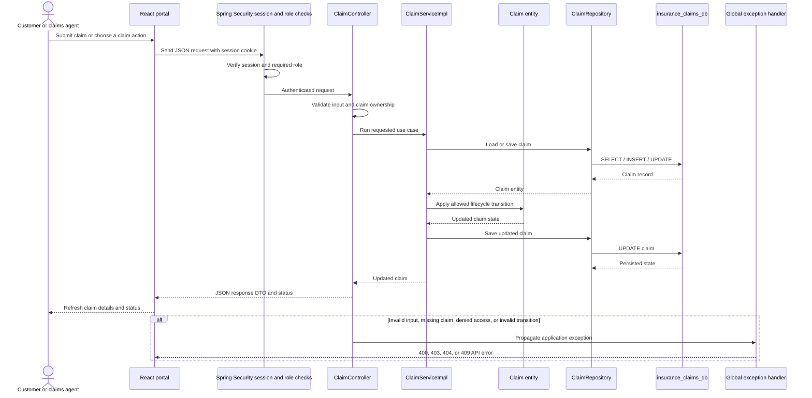
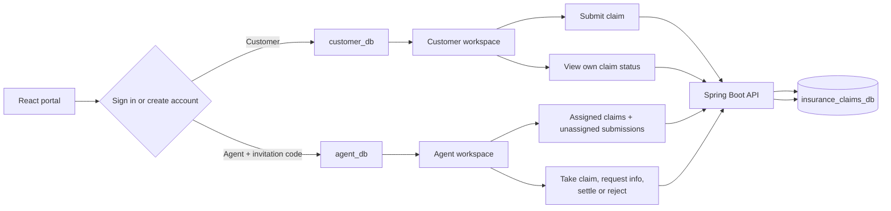
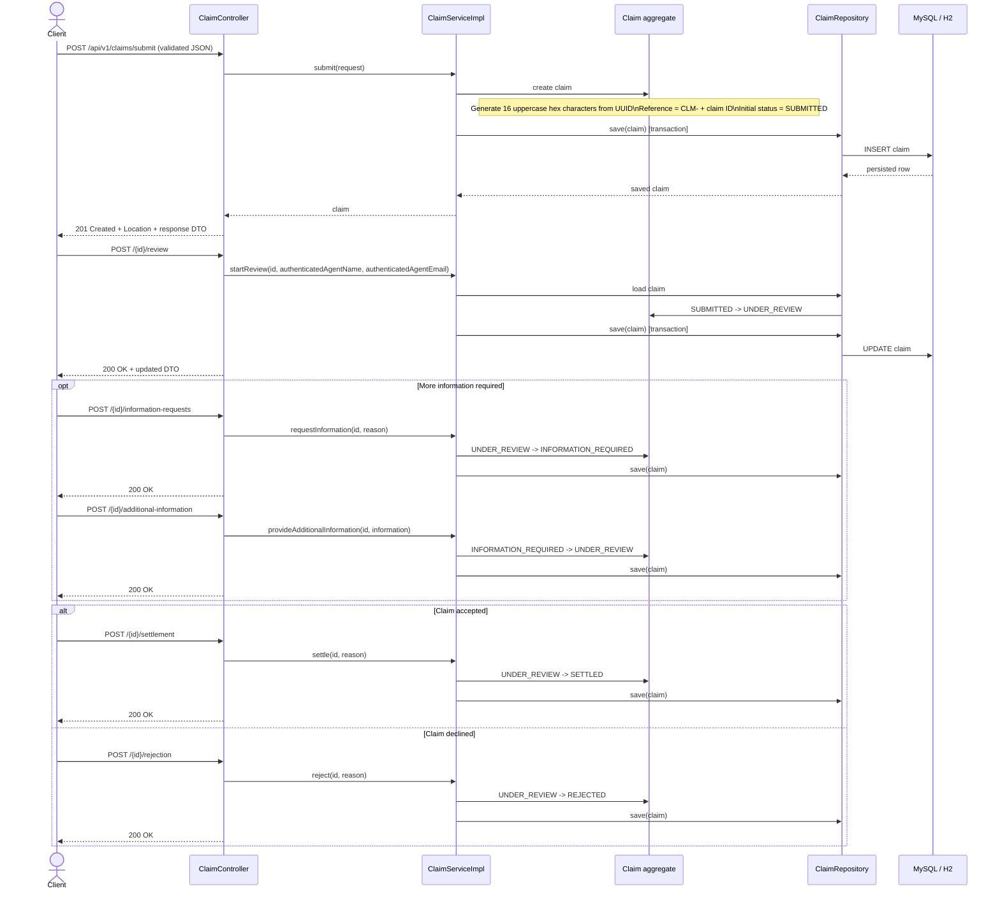
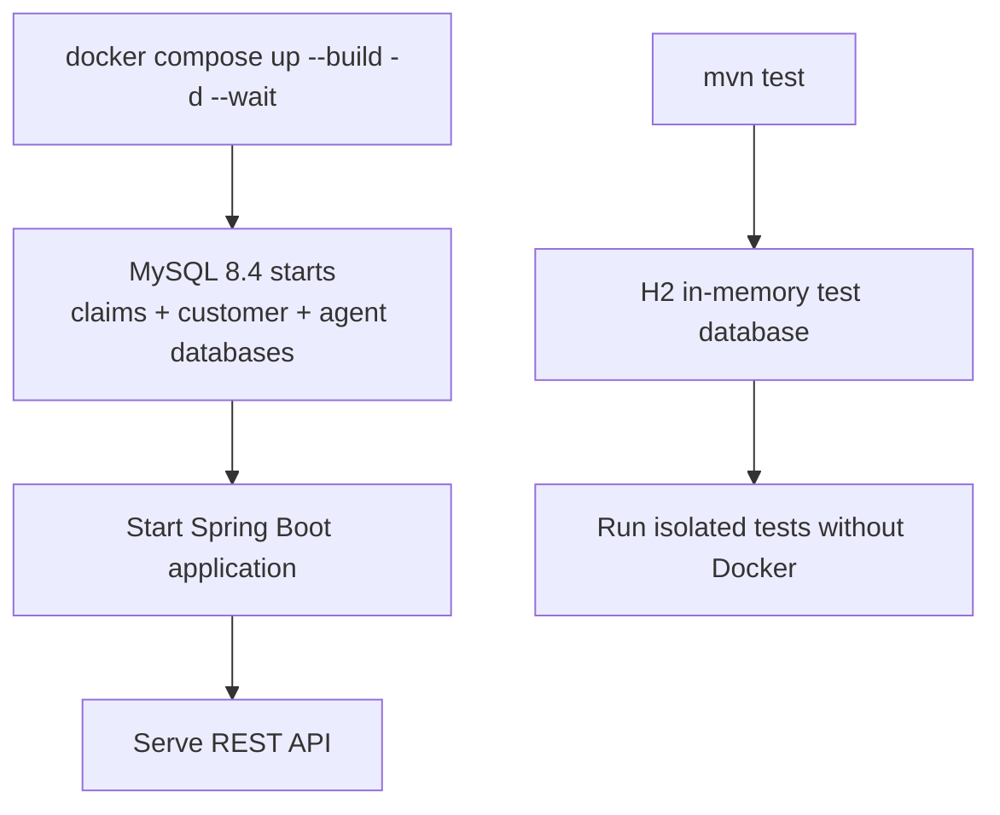

# Architecture and workflows

This document describes the application as currently implemented. It is a synchronous Spring Boot modular monolith with a React customer/agent portal; it does not currently use a message broker or separate microservices.

## Technology stack

| Area | Technology | Role |
|---|---|---|
| Language/runtime | Java 21 | Application and tests |
| Application framework | Spring Boot 3.4.5 | Application lifecycle and dependency injection |
| HTTP API | Spring MVC | Versioned REST endpoints under `/api/v1/claims` |
| Authentication | Spring Security HTTP session | Role-aware customer/agent login; BCrypt password hashes |
| Web portal | React 18, Vite | Customer submissions/tracking and agent queue/review actions |
| Input validation | Jakarta Bean Validation | Validates request DTOs at the API boundary |
| Persistence | Spring Data JPA / Hibernate | Repository abstraction and ORM mapping |
| Runtime database | MySQL 8.4 | Local application persistence |
| Test database | H2 in-memory | Isolated integration-test persistence |
| Build and tests | Maven, Spring Boot Test, JUnit 5, Mockito | Build, unit, mock, and integration tests |
| Local orchestration | Docker Compose | Starts MySQL |

## Architecture



The controller owns HTTP routing and request/response concerns. `ClaimServiceImpl` coordinates use cases and transaction boundaries. The `Claim` entity enforces lifecycle transitions. `ClaimRepository` is the persistence boundary, and `ClaimMapper` maps entities to API DTOs. The reference-tracking route returns a limited DTO that excludes claimant personal information.

Customer and agent credentials are stored in separate MySQL databases on the same local MySQL server. `CustomerAccount` maps to the `customer_db` catalog and `AgentAccount` maps to the `agent_db` catalog; claims map to `insurance_claims_db`. The API authenticates with an HTTP session, hashes passwords with BCrypt, and checks roles and claim ownership on protected routes. Registration checks for the normalized email in both account repositories before saving to the selected role's database. Agent registration also checks the configured invitation code; set `AGENT_REGISTRATION_CODE` to a private value outside local development. Submissions in `SUBMITTED` status are available to agents, and taking one assigns it to the signed-in agent.


Registration is intentionally global across both account stores: the same email cannot be registered once as a customer and again as an agent. The lookup is case-insensitive. Sign-in remains role-specific and only searches the database associated with the role selected on the sign-in form.

## Claim request and response data flow



The browser sends the session cookie with each protected request. The controller derives the customer's email or agent identity from the authenticated principal instead of trusting a client-supplied identity. For claim details, customers can access claims associated with their account; agents can access assigned claims and eligible unassigned submissions. Reference lookups are authenticated and return the limited `ClaimTrackingResponse`.

## Customer and agent portal workflow



## Claim submission and lifecycle workflow



Allowed transitions are `SUBMITTED -> UNDER_REVIEW -> INFORMATION_REQUIRED -> UNDER_REVIEW -> SETTLED` or `REJECTED`. Settlement and rejection require `UNDER_REVIEW`. Invalid transitions are reported as HTTP 409; a missing claim returns 404, and invalid request data returns 400.

## Startup and local environment workflow



Docker Compose initializes MySQL and its three databases. The Spring Boot application creates the customer and agent account tables at startup. The React development server proxies API calls to the backend; run it separately with `npm run dev`.

## REST API

Authentication endpoints are relative to `/api/v1/auth`.

| Method | Path | Purpose |
|---|---|---|
| `POST` | `/register` | Register a customer or agent; duplicate email returns 409 |
| `POST` | `/login` | Authenticate against the account store selected by role |
| `GET` | `/session` | Return the current authenticated user's profile |
| `POST` | `/logout` | Invalidate the current HTTP session |

All paths are relative to `/api/v1/claims`.

| Method | Path | Purpose |
|---|---|---|
| `POST` | `/submit` | Submit a claim; returns 201 and a `Location` header |
| `GET` | `/` | List claims; optional `?status=UNDER_REVIEW` |
| `GET` | `/{claimId}` | Retrieve a claim by internal ID |
| `GET` | `/reference/{reference}` | Authenticated reference lookup returning limited claim information |
| `POST` | `/{id}/review` | Assign the signed-in agent and start review |
| `POST` | `/{id}/information-requests` | Request additional information |
| `POST` | `/{id}/additional-information` | Submit requested information |
| `POST` | `/{id}/settlement` | Settle a reviewed claim |
| `POST` | `/{id}/rejection` | Reject a reviewed claim |
| `GET` | `/agent/queue` | List claims available to or assigned to the signed-in agent |

## Identifier and persistence notes

The internal `claimId` is the first 16 hexadecimal characters of a random UUID, stored uppercase, and mapped to `CLAIM_ID` with length 16. The public reference is `CLM-` followed by the internal ID. Truncating a UUID to 16 hexadecimal characters reduces collision resistance compared with storing the full UUID; the database uniqueness constraint is still enforced. Claims use optimistic locking via the `VERSION` field. Runtime schema configuration is `spring.jpa.hibernate.ddl-auto=update`; tests use `create-drop` against H2.

## Source layout

```text
src/main/java/com/chubb/claims/
  ClaimsApplication.java
  auth/
    controller/       # Registration, sign-in, session, and sign-out
    domain/           # Account roles and authenticated principal
    dto/              # Authentication request and response DTOs
    entity/           # Customer and agent account mappings
    repository/       # Role-specific Spring Data JPA repositories
    service/          # Registration and authentication rules
  claim/
    controller/       # REST controller
    api/dto/          # Request and response DTOs
    api/mapper/       # Entity-to-DTO mapping
    domain/           # Status and market types
    entity/           # Claim persistence model and lifecycle behavior
    repository/       # Spring Data repository
    service/          # Use-case contract and implementation
  config/             # Secrets Manager startup integration
  exception/          # API exception handling
src/test/java/com/chubb/claims/
  claim/domain/       # Lifecycle and ID unit tests
  claim/service/      # Mocked service tests
  claim/api/          # REST and persistence integration tests
  config/             # Startup-configuration tests
```

## Build and verification

```shell
mvn test
```

Integration tests use H2 and MockMvc, so no Docker services are required for the test suite. For local runtime, start infrastructure and then the application:

```shell
docker compose up --build -d --wait
mvn spring-boot:run
```

## Current boundaries and follow-up architecture

This is one deployable application and one MySQL server with three databases: claims, customer accounts, and agent accounts. Database migrations, audit history, pagination, production identity management, MFA, session hardening, and market-specific policy rules are not currently implemented. Kafka or other asynchronous messaging and separately deployed services are intentionally outside the current design; they can be introduced when a concrete integration or scaling requirement exists.
